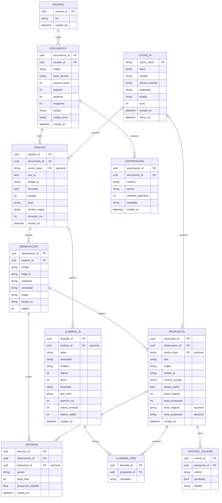

# Modelo de datos para medir Lumi

**Estado:** propuesta, nada de esto está implementado · **Fecha:** 25/11/2026 ·
**Área:** Data

Define qué persistir para calcular el [plan de medición](01-plan-de-medicion.md),
reutilizar respuestas de la IA ([economía](04-economia-ia.md)) y comprobar su
[calidad](05-calidad-y-pruebas.md).

## 1. Principios

- **Mínimo necesario:** se guardan conteos y estados, no el material.
- **Sin datos personales:** usuario con identificador anónimo y sin nombre de
  archivo, que puede contener nombres.
- **Respuestas de la IA reutilizables:** se pueden guardar y reutilizar cuando se
  envíe un contenido idéntico, según se informa en los términos y condiciones, con
  un plazo de borrado.
- **Texto original:** no se guarda por defecto. Guardarlo requiere definir para
  qué, informarlo y fijar un plazo.
- **Lo del docente es privado:** sus decisiones y ediciones no se comparten. La
  caché contiene solo respuestas de la IA.
- **Historial:** las decisiones se agregan como filas nuevas, no se pisan.

## 2. Diagrama entidad-relación

## 3. Entidades

| Entidad         | Una fila es                                    | La registra        | ¿El dato existe hoy en Lumi?             |
| --------------- | ---------------------------------------------- | ------------------ | ---------------------------------------- |
| USUARIO         | Una persona o navegador anónimo                | Frontend           | No                                       |
| DOCUMENTO       | Un material cargado (hoy, una sesión)          | Backend            | Sí, en memoria                           |
| ANALISIS        | Una corrida del diagnóstico                    | Backend            | Sí, en memoria (sin duración ni versión) |
| OBSERVACION     | Una barrera detectada                          | Backend            | Sí, en memoria                           |
| PROPUESTA       | Una adaptación mostrada a un usuario           | Backend            | Se genera y no se guarda                 |
| DECISION        | Aplicar, descartar o deshacer                  | Frontend → Backend | Solo en el navegador                     |
| LLAMADA_IA      | Un pedido al proveedor, incluidos reintentos   | Backend            | No                                       |
| LLAMADA_ITEM    | Una propuesta incluida en un pedido            | Backend            | No                                       |
| CACHE_IA        | Una respuesta reutilizable de la IA            | Backend            | No                                       |
| CONTROL_CALIDAD | El resultado de un control sobre una propuesta | Backend            | No                                       |
| EXPORTACION     | Una descarga o vista previa del PDF            | Frontend y backend | No                                       |

`LLAMADA_ITEM` permite que un pedido por lotes incluya varias propuestas. Una
propuesta resuelta con caché no tiene ninguna llamada.

### Valores permitidos

| Campo                | Valores                                                   |
| -------------------- | --------------------------------------------------------- |
| `DOCUMENTO.origen`   | `pdf`, `text`                                             |
| `ANALISIS.estado_ia` | `ok`, `unavailable`, `skipped`                            |
| `OBSERVACION.origen` | `rule`, `ai`                                              |
| `PROPUESTA.tipo`     | `simplify`, `clarify`, `describe`, `alt_text`, `sequence` |
| `PROPUESTA.origen`   | `ai`, `local`, vacío si no hubo texto                     |
| `DECISION.accion`    | `aplicada`, `aplicada_editada`, `descartada`, `deshecha`  |
| `LLAMADA_IA.tarea`   | `diagnostico`, `adaptacion`                               |
| `CACHE_IA.estado`    | `activa`, `invalidada`                                    |
| `EXPORTACION.metodo` | `backend`, `navegador`                                    |

`OBSERVACION.codigo` es el identificador actual (`regla:bloque`). Se repite entre
documentos, por eso la clave es `observacion_id`.

Una `DECISION` sin `propuesta_id` significa que se descartó la observación sin
pedir propuesta.

## 4. Cambios necesarios en la app

| #   | Cambio                                                                    | Equipo             | Habilita                   |
| --- | ------------------------------------------------------------------------- | ------------------ | -------------------------- |
| 1   | Agregar base de datos en lugar del almacenamiento en memoria              | Backend            | Todo                       |
| 2   | Enviar `session_id` y el id de la observación en `POST /adaptations`      | Backend y Frontend | Unir propuesta con barrera |
| 3   | Endpoint para registrar decisiones (aplicar, editar, descartar, deshacer) | Backend y Frontend | Aceptación                 |
| 4   | Registrar cada llamada a la IA con modelo, latencia, tokens y error       | Backend            | Funcionamiento de la IA    |
| 5   | Avisar la exportación hecha en el navegador (no pasa por el backend)      | Frontend           | Embudo completo            |
| 6   | Identificador anónimo de usuario                                          | Frontend           | Usuarios que vuelven       |
| 7   | Versionar reglas, prompts y extractor                                     | Backend            | Comparar versiones y caché |
| 8   | Consultar la caché antes de llamar a la IA                                | Backend            | Ahorro de pedidos          |

Hoy el frontend ya distingue entre aplicar la propuesta tal cual y aplicarla
editada ([SuggestionCard.tsx](../../frontend/src/components/editor/SuggestionCard.tsx)),
pero usa la misma función para ambas: hay que informar cuál fue.

## 5. Implementación por partes

| Etapa | Entidades                                    |
| ----- | -------------------------------------------- |
| 1     | DOCUMENTO, ANALISIS, OBSERVACION, LLAMADA_IA |
| 2     | USUARIO, PROPUESTA, DECISION, EXPORTACION    |
| 3     | LLAMADA_ITEM, CONTROL_CALIDAD, CACHE_IA      |
