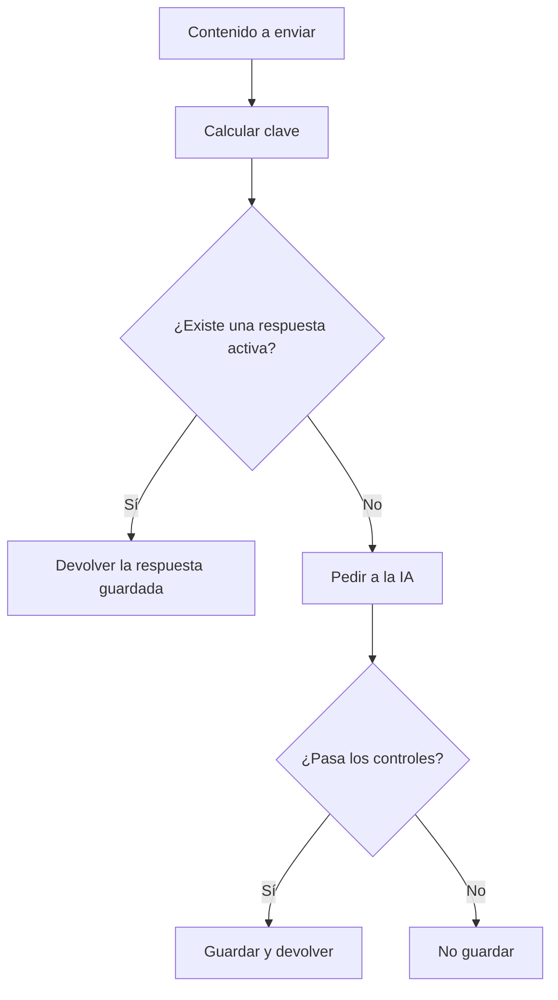

# Economía de la IA: lotes, caché y cupos

**Estado:** propuesta · **Fecha:** 25/11/2026 · **Área:** Data

## 1. El problema

Hoy Lumi usa 1 pedido para el diagnóstico y 1 o 2 por cada adaptación. En la capa
gratuita de OpenRouter el límite es por **cantidad de pedidos**: 50 por día, o
1.000 si la cuenta compró al menos 10 USD de crédito. En Gemini los límites
dependen del modelo y del proyecto ([sección 5](#5-gemini-en-la-capa-gratuita)).

Hay tres formas complementarias de gastar menos: pedir por lotes, no repetir lo
ya respondido y no desperdiciar pedidos por errores.

## 2. Pedidos por lotes

Un pedido lleva varios textos, cada uno con un código, y la IA devuelve un JSON
con una respuesta por código.

### 2.1 Resultados del laboratorio (Rampa, 21/10/2026)

Pedidos necesarios para preparar todas las propuestas de cada material:

| Material                          | Páginas | De a uno | Por lotes |
| --------------------------------- | ------- | -------- | --------- |
| Material de prueba                | 1       | 5        | 3         |
| Guía de accesibilidad (fragmento) | 3       | 26       | 9         |
| Guía de Lengua y Literatura       | 10      | 10       | 3         |
| Guía de accesibilidad (fragmento) | 10      | 95       | 28        |
| Guía de accesibilidad (completa)  | 30      | 246      | 62        |

Materiales de 3 páginas que entran por día con 50 pedidos:

| Perfil                      | De a uno | Por lotes |
| --------------------------- | -------- | --------- |
| Con muchas imágenes         | 1        | 5         |
| Mixto (estimado, no medido) | 3        | 8         |
| Mayormente texto            | 12       | 16        |

Configuración usada: hasta 8 textos o 5.000 caracteres, o hasta 3 imágenes, por
pedido.

### 2.2 Qué significaría en Lumi

Cálculo teórico, sin reintentos, con lotes de 8:

| Adaptaciones por documento | Pedidos hoy | Pedidos por lotes | Documentos por día, hoy | Documentos por día, por lotes |
| -------------------------- | ----------- | ----------------- | ----------------------- | ----------------------------- |
| 5                          | 6           | 2                 | 8                       | 25                            |
| 10                         | 11          | 3                 | 4                       | 16                            |
| 20                         | 21          | 4                 | 2                       | 12                            |

No son comparables con la tabla del laboratorio: Lumi no envía imágenes a la IA y
hoy solo pide las adaptaciones que el docente solicita. El beneficio real depende
de cuántas se terminen usando.

### 2.3 Cómo implementarlo

1. Endpoint nuevo que reciba varias observaciones.
2. Cada ítem con el identificador de su observación.
3. Validar cada respuesta por separado con los controles actuales.
4. Si el JSON llega cortado, conservar los ítems completos.
5. Volver a pedir solo los que falten.

### 2.4 Cuándo conviene

| Tipo de cuenta                | Estrategia                                 | Motivo                   |
| ----------------------------- | ------------------------------------------ | ------------------------ |
| Gratuita (límite por pedidos) | Preparar por lotes después del diagnóstico | Aprovecha cada pedido    |
| Paga (cobra por tokens)       | Pedir cuando el docente abre la propuesta  | No paga lo que no se usa |

Riesgos: un fallo afecta a varios ítems, la calidad puede bajar con lotes grandes
y preparar todo de antemano consume tokens en propuestas que quizá no se abran.

### 2.5 Tiempo de espera

Un lote tarda más que un pedido individual. **Lumi corta los pedidos a OpenRouter
a los 30 segundos** (`OPENROUTER_TIMEOUT_SECONDS`), y en el laboratorio el 5 % más
lento de los lotes de texto superó los 31 segundos
([mediciones](05-calidad-y-pruebas.md)).

Antes de activar los lotes hay que medir la latencia con el modelo y el tamaño de
lote de Lumi, y ajustar ese límite.

## 3. Caché de respuestas mediante hash

**Idea:** si ya se le preguntó a la IA por un contenido idéntico, devolver la
respuesta guardada, aunque lo suba otra persona.

### 3.1 Flujo

### 3.2 La clave

Un hash (SHA-256) de todo lo que influye en la respuesta:

| Componente                                              | Por qué                                                 |
| ------------------------------------------------------- | ------------------------------------------------------- |
| Tarea (diagnóstico o adaptación)                        | Respuestas distintas                                    |
| Texto enviado, normalizado                              | Se unifican espacios y se conservan los saltos de línea |
| Tipo de adaptación y regla                              | Cambian la instrucción                                  |
| Título, detalle, recomendación y contexto, si se envían | Forman parte del pedido                                 |
| Proveedor y modelo                                      | Cada modelo responde distinto                           |
| Versión del prompt                                      | Al mejorarlo, no se reutiliza lo viejo                  |
| Versión del extractor                                   | El diagnóstico apunta a identificadores de bloque       |

### 3.3 Niveles

| Nivel     | Se reutiliza cuando                         | Sirve para                          |
| --------- | ------------------------------------------- | ----------------------------------- |
| Documento | El texto enviado al diagnóstico es idéntico | El mismo material subido otra vez   |
| Bloque    | El fragmento y su pedido son idénticos      | Consignas y párrafos que se repiten |

El hash del archivo sirve para reconocer una nueva subida exacta, pero un cambio
mínimo en el PDF lo modifica por completo. Por eso la clave principal se calcula
sobre el texto.

### 3.4 Reglas

- Se guarda **solo la respuesta de la IA** que pasó los controles.
- Las ediciones del docente son personales: se guardan aparte y no se comparten.
- No se guardan errores ni resultados del fallback local.
- **"Pedir otra versión"** no usa la caché.
- Una respuesta que se descarta seguido se invalida.
- Las entradas vencen después de un plazo a definir.

### 3.5 Privacidad

Las respuestas de la IA se pueden guardar y reutilizar cuando se envíe un
contenido idéntico, según se informa en los **términos y condiciones**, que el
docente acepta una vez. No se pide consentimiento por cada respuesta. Las
ediciones del docente no se comparten.

La caché solo responde a quien envía el mismo texto. Aun así:

- el hash **no anonimiza** la respuesta guardada, que puede contener datos
  presentes en el material;
- quien sube un material no siempre es dueño de todo su contenido;
- hay que definir plazo de conservación y forma de borrar;
- no se usa con datos personales de estudiantes.

El texto de los términos debe validarlo alguien con conocimiento legal.

## 4. No desperdiciar pedidos

Lecciones del laboratorio:

| Situación                                | Qué hacer                                                                 |
| ---------------------------------------- | ------------------------------------------------------------------------- |
| Error 429 por modelo saturado            | Esperar y reintentar una vez, o pasar a otro modelo                       |
| Error 429 por cupo diario agotado        | Dejar de pedir; en OpenRouter se confirma consultando el cupo de la clave |
| Modelo caído                             | OpenRouter acepta una lista de hasta 3 modelos alternativos               |
| Respuesta vacía en modelos que "razonan" | Limitar los tokens de razonamiento                                        |
| Respuesta cortada                        | Rescatar los ítems completos                                              |
| Pruebas durante el desarrollo            | Procesar pocas páginas                                                    |

Observaciones puntuales, sin garantía: la cuenta superó una vez los 50 pedidos, y
en una prueba se descontaron más pedidos que los realizados.

Pasar a un proveedor pago debe requerir autorización explícita.

## 5. Gemini en la capa gratuita

### 5.1 Condiciones según la documentación oficial (25/11/2026)

| Tema                        | `gemini-3.8-flash` y `gemini-3.6-flash` | `gemini-3.5-flash-lite` |
| --------------------------- | --------------------------------------- | ----------------------- |
| Capa gratuita               | Sí                                      | Sí                      |
| _Context caching_ sin costo | Sí                                      | No                      |

- Los límites se aplican **por proyecto**, no por clave, y se miden en pedidos por
  minuto, tokens por minuto y pedidos por día.
- El cupo diario se reinicia a la medianoche del Pacífico.
- En la capa gratuita, Google usa el contenido para mejorar sus productos.
- Google no publica los límites gratuitos de estos modelos: se consultan en
  [AI Studio](https://aistudio.google.com/rate-limit).
- El _context caching_ de Google no reemplaza la caché por hash: esta última evita
  hacer el pedido.
- La _Batch API_ de Google es distinta de los lotes dentro de un pedido que se
  proponen acá, y no está disponible sin costo en los modelos 3.8 y 3.6.

El modelo configurado por defecto en Lumi, `gemini-2.0-flash`, está dado de baja
([análisis de la IA](03-analisis-ia.md)).

### 5.2 Límites reportados, a confirmar

Cifras de sitios de terceros a octubre de 2026. **No son oficiales.**

| Modelo                                  | Pedidos por minuto | Tokens por minuto | Pedidos por día |
| --------------------------------------- | ------------------ | ----------------- | --------------- |
| `gemini-3.8-flash` y `gemini-3.6-flash` | 5                  | 250.000           | 20              |
| `gemini-3.5-flash-lite`                 | 15                 | 250.000           | 500             |

Fuentes:
[límites por nivel](https://www.aifreeapi.com/en/posts/gemini-api-rate-limits-per-tier)
y [capa gratuita](https://imisofts.com/blog/gemini-api-free-tier-limits/).

### 5.3 Qué significarían en Lumi

Cálculo teórico, con un diagnóstico y 10 adaptaciones por documento, sin
reintentos y con lotes de 8:

| Modelo          | Documentos por día, hoy (11 pedidos) | Documentos por día, por lotes (3 pedidos) |
| --------------- | ------------------------------------ | ----------------------------------------- |
| Flash 3.8 o 3.6 | 1                                    | 6                                         |
| Flash-Lite 3.5  | 45                                   | 166                                       |

Si las cifras se confirman:

- elegir el modelo pesa tanto como pedir por lotes;
- con 5 pedidos por minuto, pedir varias propuestas seguidas alcanzaría el límite;
- la calidad de Flash-Lite se debe comprobar con el
  [protocolo de pruebas](05-calidad-y-pruebas.md) antes de elegirlo.

### 5.4 Datos pendientes del equipo

- [ ] Límites que muestra AI Studio en el proyecto de la clave de Lumi.
- [ ] Valor de `GEMINI_MODEL` en el servidor.
- [ ] Si el proyecto tiene la facturación activada.

### 5.5 Context caching: evaluado, no se recomienda por ahora

**Qué es:** reutiliza el comienzo repetido de un pedido. No guarda respuestas ni
ahorra pedidos.

**Por qué no:** las instrucciones de Lumi son cortas frente al mínimo de 4.096
tokens, el cupo gratuito diario se gasta igual y no hay costo que reducir.

**Cuándo revisarlo:** si se pasa a un plan pago y se envía un mismo contenido
extenso en muchos pedidos.

## 6. Cómo medirlo

| Métrica                | Cálculo                                    |
| ---------------------- | ------------------------------------------ |
| Pedidos por documento  | Pedidos / documentos analizados            |
| Aciertos de caché      | Resueltos con caché / consultas a la caché |
| Ítems por pedido       | Ítems enviados / pedidos por lotes         |
| Pedidos desperdiciados | Pedidos sin respuesta utilizable / pedidos |
| Propuestas no abiertas | Preparadas que nadie vio / preparadas      |

## 7. Orden sugerido

1. Confirmar el modelo y los límites del proyecto de Gemini.
2. Registrar cada pedido, para conocer el consumo actual.
3. Distinguir los errores 429.
4. Probar lotes y comparar calidad contra pedidos de a uno.
5. Implementar la caché cuando exista la base de datos.

Referencias:

- [Límites de OpenRouter](https://openrouter.ai/docs/api/reference/limits). Las
  cifras se tomaron de resultados de búsqueda y conviene confirmarlas.
- Gemini: [límites](https://ai.google.dev/gemini-api/docs/rate-limits),
  [precios](https://ai.google.dev/gemini-api/docs/pricing),
  [facturación](https://ai.google.dev/gemini-api/docs/billing) y
  [context caching](https://ai.google.dev/gemini-api/docs/caching).
